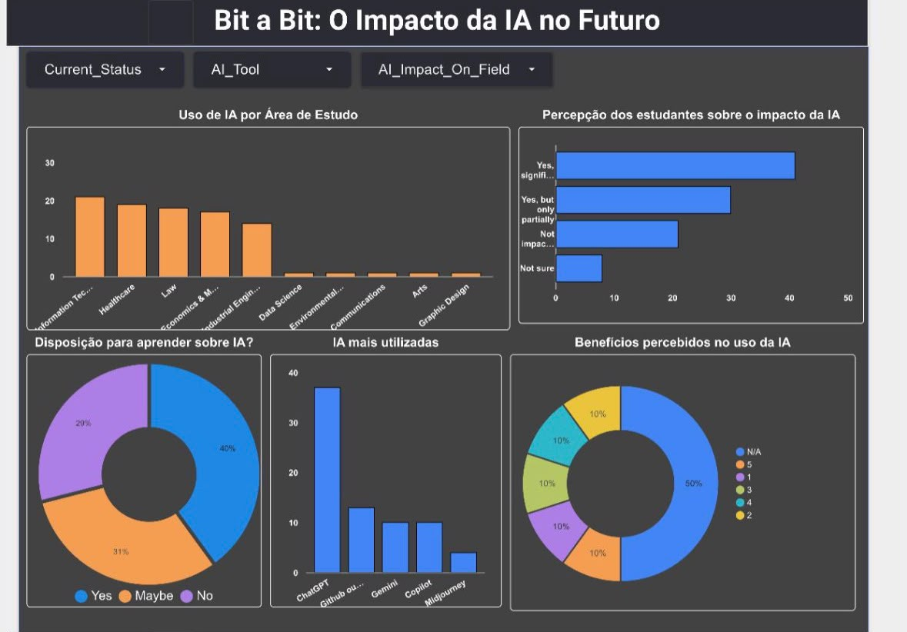

# 💡 Projeto Final - Engenharia de Dados  
## **Bit a Bit: Percepções sobre o Impacto da Inteligência Artificial na Carreira**

### 📌 Visão Geral

Este projeto analisa como estudantes e profissionais percebem o impacto da Inteligência Artificial (IA) em suas rotinas acadêmicas e profissionais. Utilizamos um dataset sintético contendo **500 respostas** de uma pesquisa global, tratando desde o uso da IA na graduação até a expectativa sobre o futuro do trabalho.

---

### 🎯 Objetivos do Projeto

- Investigar o impacto da IA no ambiente acadêmico e no mercado de trabalho.
- Identificar padrões de uso de ferramentas de IA e percepções relacionadas.
- Criar um dashboard interativo com indicadores descritivos e insights estratégicos.

---

### 🧰 Tecnologias Utilizadas

- **Google BigQuery** – Ingestão, limpeza e análise dos dados com SQL.
- **Looker Studio** – Criação do dashboard interativo e visualização dos dados.
- **Google Cloud Platform** – Ambiente de processamento e armazenamento dos dados.

---

### 🗂️ Dataset

- **Fonte:** Dataset sintético de percepção sobre IA  🔗 [Acessar a fonte](https://www.kaggle.com/datasets/ahmadindragiri/ai-and-future-careers-synthetic-survey-data)
- **Nome no BigQuery:** `t1engenhariadados.bit_a_bit.respondents_ai_impact_synthetic`  
- **Total de registros:** 500 linhas  
- **Total de colunas:** 23 variáveis mistas (quantitativas e qualitativas)  
- 🔗 [Acessar no BigQuery](https://console.cloud.google.com/bigquery?ws=!1m4!1m3!3m2!1st1engenhariadados!2sbit_a_bit)

---

### 🔄 Pipeline de Processamento

1. **Ingestão dos dados** via interface gráfica do BigQuery
2. **Verificação de nulos** (`COUNTIF`) – Nenhum valor ausente foi identificado
3. **Padronização e limpeza** de valores inconsistentes (`UPDATE`)
4. **Classificação de variáveis** (qualitativas vs. quantitativas)
5. **Análise descritiva** com métricas estatísticas e distribuições
6. **Criação do dashboard** no Looker Studio

---

### 📊 Dashboard Interativo


*Dashboard no Looker Studio (link temporariamente indisponível por mudança de permissões na fonte de dados).*

**Principais funcionalidades:**
- Filtros por área de estudo e status profissional
- Distribuição de respostas por escala de Likert
- Análises cruzadas entre idade, uso de IA e percepção de carreira

---

### 📌 Principais Descobertas

- 🧠 **Utilidade percebida da IA é alta**: nota média de **4.2** em tarefas acadêmicas.
- 📈 **ChatGPT domina o uso** em ambientes acadêmicos (55,3%).
- 👩‍🎓 **Perfil dominante**: jovens estudantes/profissionais de TI com idade média de 26,8 anos.
- 💼 **57% preferem empregos com IA** e **51% temem perda de empregos**.
- 📚 **87% reconhecem a necessidade de capacitação** contínua em IA.

---

### ✅ Recomendações Estratégicas

- **Fomentar capacitação em IA** de forma segmentada por área.
- **Revisar currículos acadêmicos** para integrar IA formalmente.
- **Diversificar o uso de ferramentas** além do ChatGPT.
- **Planejar políticas de transição no mercado de trabalho** com base nas percepções de risco.

---

### ⚠️ Limitações

- **Dataset sintético**: embora útil para testes, não reflete dados reais.
- **Viés na amostra**: maioria dos respondentes são da área de tecnologia.
- **Algumas variáveis com excesso de valores "N/A"** limitaram análises mais profundas.

---

### 🧠 Lições Aprendidas

- A importância de padronizar dados antes da análise para evitar distorções.
- Como cruzar variáveis qualitativas e quantitativas de forma eficiente no BigQuery.
- A relevância de alinhar visualizações com a jornada de análise para facilitar a tomada de decisão.

---

### 🚀 Próximos Passos

- Explorar modelagem preditiva com base nas percepções dos respondentes.
- Refinar as visualizações para públicos externos ao meio técnico.
- Incluir comparativos entre diferentes regiões ou áreas de atuação.

---

### 👥 Integrantes do Projeto

- **Ana Beatriz Almeida** – Responsável pela extração dos dados e condução da análise crítica dos resultados. [LinkedIn](https://www.linkedin.com/in/ana-beatriz-almeida-dados/)
- **Andressa de Oliveira Madureira** – Desenvolvimento das visualizações interativas no Looker Studio. [LinkedIn](https://www.linkedin.com/in/andressa-omadureira)
- **Barbara Camargo Bezerra** – Responsável pelas análises estatísticas e sumarização dos dados quantitativos. [LinkedIn](https://www.linkedin.com/in/bcb-bcb)
- **Camila Farias do Prado** – Classificação e estruturação das variáveis qualitativas e quantitativas. [LinkedIn](https://www.linkedin.com/in/camilafprado)
- **Kimberly Carneiro dos Santos** – Realização da limpeza, padronização e tratamento de inconsistências nos dados. [LinkedIn](https://www.linkedin.com/in/kimberly-carneiro-santos)
- **Kleiton Luis de Oliveira Souza** – Apoio nas análises estatísticas e elaboração de indicadores descritivos. [LinkedIn](https://www.linkedin.com/in/kleitonluis)
- **Vera Lucia Tavares Feitoza** – Criação de gráficos e dashboards com foco na comunicação dos insights. [LinkedIn](https://www.linkedin.com/in/vera-lúcia-tavares-feitoza-ba66a0131)
- **Wanessa Regina Martins Cavalcante** – Apoio na normalização e transformação dos dados para análise. [LinkedIn](https://www.linkedin.com/in/psicare-wancavalcanti)

### 📂 Organização do Repositório

```
├── README.md
├── scripts/
│   └── consultas_sql.sql
├── data/
│   └── respondents_ai_impact_synthetic.csv
├── notebooks/
│   └── analise_dados_bigquery.md
├── dashboard/
│   └── link_looker_studio.txt
```
